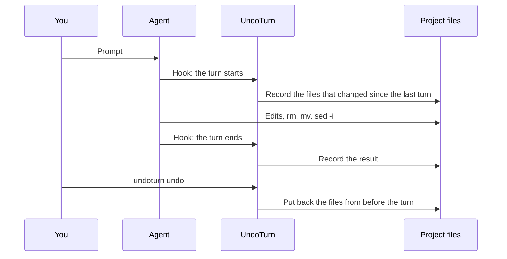

<div align="center">


# UndoTurn

**Every prompt is a save point. Undo for coding agents on macOS.**

[Quick start](#quick-start) &nbsp;·&nbsp; [User guide](docs/GUIDE.md) &nbsp;·&nbsp; [How it works](#how-it-works) &nbsp;·&nbsp; [FAQ](#faq)

<sub>One command. One click. Ten agent CLIs. No network, no account, no telemetry.</sub>

[](https://github.com/HugoLopes45/undoturn/actions/workflows/ci.yml)


[](LICENSE)
[](CONTRIBUTING.md)
[](https://github.com/HugoLopes45/undoturn/releases/latest)

<br>

<a href="https://github.com/HugoLopes45/undoturn/releases/latest/download/UndoTurn.dmg">
  
</a>
&nbsp;
<a href="https://github.com/HugoLopes45/undoturn/releases/latest/download/undoturn-macos-universal.tar.gz">
  
</a>

<sub>macOS 14 or later &nbsp;·&nbsp; [all releases](https://github.com/HugoLopes45/undoturn/releases)</sub>

<br>
<br>

<picture>
  <source media="(prefers-color-scheme: dark)" srcset="docs/images/timeline-dark.png">
  
</picture>

</div>

---

> **Status: early (0.x).** Recording, undo and the menu bar app support Claude Code, Codex CLI, Gemini CLI, Cursor CLI, GitHub Copilot CLI, Factory Droid, Devin CLI, OpenCode, Pi and Oh My Pi. Commands and storage can change before 1.0. [Download the latest release](#quick-start).

## Why

Your agent works for ten minutes. It touches 40 files. The build breaks, and you do not know which change caused it.

UndoTurn records your project before and after each agent turn. When a turn goes wrong, you go back to the moment before that prompt. You do not need to make a commit, use a stash or read a transcript.

```console
$ undoturn list
#2 *  2026-10-23 09:49  claude  +0 ~0 −5  Clean up the project and remove unus…
#1    2026-10-23 09:49  claude  +1 ~1 −0  Add a health check endpoint

$ undoturn undo
restored: src/health.ts
restored: src/items.ts
restored: src/routes.ts
restored: src/server.ts
restored: tests/items.test.ts
```

The agent "cleaned up" by deleting `src/` and `tests/`. One command brought back all five files.

- **No action from you.** Hooks record each prompt. You do not commit, stash or tag.
- **Shell commands too.** UndoTurn compares the files themselves, so `rm`, `mv` and `sed -i` are undone like any edit.
- **Local only.** Everything stays on your Mac. UndoTurn never writes to `.git` and never makes commits.

## Features

<table>
<tr>
<td width="50%" valign="top">

### ⏪ Undo the last turn

One command or one click puts back the files from before the prompt. Redo applies it again.


</td>
<td width="50%" valign="top">

### 🌳 History is a tree

If you undo and send a new prompt, the old branch stays. **Go to #N** brings it back.


</td>
</tr>
<tr>
<td width="50%" valign="top">

### ✂️ Revert one turn, restore one file

**Revert Just This Turn…** records an inverse and keeps the later turns. **Restore File or Folder…** selects a recorded version and does not move history.


</td>
<td width="50%" valign="top">

### 📋 Undo from the menu bar

Undo and redo for each project, recent turns, storage, hook setup and Pause Recording, in one menu.


</td>
</tr>
</table>

**Also in the box:**

- **Your edits are safe.** If you change a file after a turn and then undo that turn, UndoTurn keeps your version and tells you. Only `--force` overwrites it.
- **Shared intervals.** Prompt boundaries record changes. Overlapping sessions share an interval; intervening edits get separate between-turns nodes.
- **Files outside the project, too.** Paths from mapped file-tool calls and shell commands are candidates, subject to the safety limits in the [guide](docs/GUIDE.md#files-outside-the-project).
- **See exactly what changed.** `undoturn show` and `undoturn diff` in the terminal, or a timeline with line diffs in the menu bar app.
- **An alert on mass deletes.** If a turn removes 50 files or more, or at least 3 files and a quarter of the project, a notification offers an undo.
- **Crash recovery.** A durable journal resumes interrupted recovery and preserves completed operations. File changes and progress records are not atomic against other writers.
- **Targeted prevention.** Claude Code, Codex, Gemini and Cursor pre-tool hooks reject recognized broad deletions, gate destructive Git operations, and checkpoint recognized risky commands. This is not a sandbox; `.git` remains excluded.
- **Fast.** Each Claude Code hook adds a median of 22 to 28 ms with the background service and 35 ms without it (20,000-file project, M1 Max). Other agents and pre-command checkpoints are not benchmarked.
- **Small on disk.** UndoTurn stores each file version as an APFS clone. A clone uses almost no space until the original file changes.
- **Agents can undo too.** `undoturn mcp` serves list, diff, undo, redo, goto and revert over MCP.

UndoTurn does not record ignored files, except `.env*` files, which it records unless `.undoturnignore` excludes them. It never records the folders `.git`, `node_modules`, `.build`, `DerivedData` and `Pods`. It does not store a copy of files larger than 50 MiB.

## Works with

<div align="center">


</div>

| Agent | Turns | Files outside the project | Hook file |
|---|---|---|---|
| Claude Code | Yes | Yes | `~/.claude/settings.json` |
| Codex CLI | Yes | Yes | `~/.codex/hooks.json`; run `/hooks` once to trust it |
| Gemini CLI | Yes | Yes (shell commands) | `~/.gemini/settings.json` |
| Cursor CLI | Yes | Yes (shell commands) | `~/.cursor/hooks.json` |
| GitHub Copilot CLI | Yes | Yes | `~/.copilot/hooks/undoturn.json` |
| Factory Droid | Yes | Yes | `~/.factory/settings.json` |
| Devin CLI | Yes | Yes | `~/.config/devin/config.json` |
| OpenCode | Yes | Yes | `~/.config/opencode/plugins/undoturn.js` |
| Pi | Yes | Yes | `~/.pi/agent/extensions/undoturn.ts` |
| Oh My Pi | Yes | Yes | `~/.omp/agent/extensions/undoturn.ts` |
| Any other command | With `undoturn run -- <command>` | No | None |

Agents with "Yes" for files outside the project also report each command and file edit. While a turn runs, the menu, the timeline and `undoturn list` show the newest one. Claude Code also reports when it waits for your permission or answer.

[`scripts/agent-drill.sh`](scripts/agent-drill.sh) includes a destructive undo/redo check through the CLI and the MCP server for Claude Code, Codex CLI, Pi and Oh My Pi, plus a one-file recording check for Copilot, Droid, Devin and OpenCode. Each new-agent run uses a temporary UndoTurn store and temporary hook configuration where the CLI supports it.

## Quick start

Requirements: macOS 14 or later.

| | Download | Install |
|---|---|---|
| **App** (menu bar app, CLI and service) | [UndoTurn.dmg](https://github.com/HugoLopes45/undoturn/releases/latest/download/UndoTurn.dmg) | Drag **UndoTurn** to **Applications**, eject the DMG and open the app. For terminal access, choose **Install Command-Line Tools…** in its menu. No separate CLI download is needed. |
| **CLI only** (CLI and service) | [undoturn-macos-universal.tar.gz](https://github.com/HugoLopes45/undoturn/releases/latest/download/undoturn-macos-universal.tar.gz) | See the commands below. |

Need help? See the [installation guide](docs/GUIDE.md#install).

With the app, read [Before you record](docs/GUIDE.md#before-you-record), then choose **Install Agent Hooks…** and select a project. Terminal access is optional.

<details>
<summary>Install the CLI without the app</summary>

```sh
curl -fLO https://github.com/HugoLopes45/undoturn/releases/latest/download/undoturn-macos-universal.tar.gz
curl -fLO https://github.com/HugoLopes45/undoturn/releases/latest/download/SHA256SUMS
shasum -a 256 -c SHA256SUMS --ignore-missing
tar -xzf undoturn-macos-universal.tar.gz
mkdir -p ~/.local/bin
cp undoturn-*-macos-universal/undoturn undoturn-*-macos-universal/undoturn-service ~/.local/bin/
export PATH="$HOME/.local/bin:$PATH"
```

Hooks store the absolute path of the CLI. Install it in a stable location before `init`, and keep `undoturn-service` beside it.

</details>

To build from source, see [Contributing](CONTRIBUTING.md#set-up).

Before `init`, read [Before you record](docs/GUIDE.md#before-you-record). In short: `init` installs hooks for all ten agents in your user account, and `.env*` files are recorded unless `.undoturnignore` excludes them. To install one agent only, use `init --agent <name>`. To try undo and redo first without hooks, follow [Your first undo and redo](docs/GUIDE.md#your-first-undo-and-redo).

Then run `init` once, in a project:

```console
$ cd ~/code/web-app
$ undoturn init
claude: installed
codex: installed
Open Codex and run /hooks once to trust the UndoTurn hook.
gemini: installed
cursor: installed
copilot: installed
droid: installed
devin: installed
opencode: installed
pi: installed
omp: installed
registered workspace: /Users/you/code/web-app
```

That is all. The hooks are global: UndoTurn records each project where an agent works, except your home folder and a few other [refused folders](docs/GUIDE.md#how-undoturn-finds-the-project). Use your agent as usual. When a turn goes wrong:

```sh
undoturn undo
```

`undoturn doctor` checks the installation. The [user guide](docs/GUIDE.md) explains each command, the menu bar app and the background service.

### The menu bar app

The app bundles the CLI and the service. The CLI and the app use the same engine and history.

On an empty timeline, choose **Install Agent Hooks…** to select a project. Setup uses the bundled CLI, not your shell's `PATH`.

For terminal access, choose **Install Command-Line Tools…**, then select a writable folder on your shell's `PATH`. This creates links to both bundled tools without replacing existing files or changing shell settings. Keep the app in its installed location; moving or deleting it breaks the links. If the chosen folder is not on `PATH`, use the full CLI path or add that folder yourself.

- Undo and redo for each project from the menu bar. `⌘Z` and `⇧⌘Z` work in the timeline. In the menu, they act on the first listed project that can undo, or redo when no turn is running there.
- A timeline of prompts, labels, changed files and line diffs, with shared participant identities and recording status.
- The running interval: its newest command or file edit. When Claude Code waits for your answer, the menu bar icon shows a dot and a notification tells you.
- **Restore File or Folder…** shows preview counts and per-file results: what was restored, removed, or kept.
- Native recovery requires all recording to stop. There is no force-through action for an active interval.
- **Install Agent Hooks…**, **Check Recording Setup…**, recent hook-failure warnings, Pause Recording and Open at Login.

## How it works



1. `undoturn init` installs the settings hooks, Copilot's UndoTurn-owned hook file, or generated Pi/OpenCode/Oh My Pi extension as appropriate; it registers the current project and stores its first state.
2. When you send a prompt, the hook records the files that changed since the last turn. UndoTurn reads `.gitignore`, but it still records `.env*` files, so that an undo can restore a deleted `.env`. `.undoturnignore` excludes them.
3. When the turn ends, the hook records the result. If the hook fails, the agent continues, and `undoturn doctor` reports the error.
4. `undoturn undo` writes back the files from before the turn. It uses a durable journal: after a crash, a recovery-capable operation such as `list` or a normal history move attempts to finish the interrupted recovery under the project lock. A preview refuses unfinished recovery. Deleting the history discards its journal without completing the recovery.

For large projects, `undoturn service install` starts an optional background service. It watches the file system with FSEvents, so that the hook reads only the files that changed.

| Part | Where | What it does |
|---|---|---|
| Engine | [`Sources/UndoTurnCore/`](Sources/UndoTurnCore/) | Scans and records files, keeps the history tree, plans and applies restores, writes the journal, installs agent hooks. |
| CLI | [`Sources/undoturn/`](Sources/undoturn/) | The `undoturn` command: hooks, history moves, storage, `doctor` and the MCP server. |
| Service | [`Sources/UndoTurnService/`](Sources/UndoTurnService/) | The optional background service that watches the file system with FSEvents. |
| Ledger | [`Sources/UndoTurnLedger/`](Sources/UndoTurnLedger/) | Builds the rows, counts and move previews that the app shows. |
| App | [`Sources/UndoTurnApp/`](Sources/UndoTurnApp/) | The menu bar app and the timeline window. |

[docs/THREAT-MODEL.md](docs/THREAT-MODEL.md) tells what UndoTurn stores, where it stores it, and its limits.

## Commands

| Command | What it does |
|---|---|
| `undoturn init` | Add the hooks to all supported agents and register this project |
| `undoturn list` | Show the turns, newest first. `*` marks the current turn |
| `undoturn show 3` | Show the prompt, the agent and the changed files of turn 3 |
| `undoturn diff 3` | Show the line diff of turn 3 |
| `undoturn undo` | Put back the files from before the last turn |
| `undoturn redo` | Apply the undone turn again |
| `undoturn undo` as the prompt in Claude Code, Codex, Gemini CLI or Cursor | Undo without leaving the agent; the hook blocks the prompt |
| `undoturn goto 2` | Move the project to turn 2, also on another branch |
| `undoturn revert 2` | Undo only turn 2 and keep the turns after it |
| `undoturn restore config.json --at 2` | Restore one file as before turn 2 without moving history |
| `undoturn undo --dry-run` | Preview a move without applying changes |
| `undoturn label 2 "works"` | Give turn 2 a name |
| `undoturn pause` / `resume` | Stop and start recording |
| `undoturn run -- make build` | Record one turn around any command |
| `undoturn doctor` | Check the hooks, the store and the recent hook errors |
| `undoturn gc` | Apply age/size retention and explicitly purge versions used only by ignored paths |
| `undoturn service install` | Start the optional background service at login |
| `undoturn mcp` | Serve list, diff, undo, redo, goto and revert to agents over MCP |
| `undoturn storage [list]` | List stored histories and reclaimable space |
| `undoturn storage remove <root>` | Permanently delete one history, never its project files |
| `undoturn uninstall` | Remove the hooks. The history stays |

Add `--json` to `list`, `show`, `diff`, `undo`, `redo`, `goto`, `revert`, `restore`, `storage`, `gc` and `doctor` for scripts. The [user guide](docs/GUIDE.md) gives all the options and exit codes.

## FAQ

**Does UndoTurn replace Git?**
No. Git keeps the history that you decide to keep. UndoTurn protects the minutes between two commits, when an agent changes many files at once.

**Does my code leave my Mac?**
No. UndoTurn makes no network connections. If you connect `undoturn mcp` to an agent, that agent receives the history it asks for. The history is in `~/Library/Application Support/UndoTurn`, and only your user can read it.

**Does it store my secrets?**
Yes, unless you exclude them. UndoTurn records `.env*` files even when `.gitignore` ignores them, so that an undo can restore them. File copies are not redacted. They stay on your Mac with mode `0600`. To keep them out, list them in `.undoturnignore`. The [threat model](docs/THREAT-MODEL.md) tells how to remove versions already stored.

**How much disk space does it use?**
Each file version is an APFS clone, which uses almost no space until the original file changes. `undoturn gc` removes the stored versions of undone turns and other branches after 30 days. It also removes the oldest of them when the store is larger than 5 GiB. In the menu bar app, **Manage Storage…** estimates the space that deleting each project's history can free, and deletes one history or all of them.

**Does it slow down my agent?**
On a 20,000-file project and an M1 Max, the median Claude Code hook time is 28 ms at the prompt and 22 ms at the stop with the background service, and 35 ms without it. A turn runs these two hooks. Other agents and pre-command checkpoints are not benchmarked.

**What if I edit files while the agent works?**
A change made during a turn belongs to that turn. An undo of that turn also undoes your change. A change made after the turn is safe: undo keeps it.

**Is UndoTurn a sandbox or a backup?**
No. UndoTurn is a recovery tool. It can not stop an agent, and its store is on the same disk as your projects. Use Time Machine as well.

## Privacy

UndoTurn makes no network connections and has no account and no telemetry. The history stays in `~/Library/Application Support/UndoTurn`, readable only by your user. UndoTurn never writes to `.git` and never makes commits.

## Contributing

Contributions are welcome. Read [CONTRIBUTING.md](CONTRIBUTING.md). Report security problems as described in [SECURITY.md](SECURITY.md).

## License

[Apache License 2.0](LICENSE)

The agent marks in the app use third-party path data. [THIRD-PARTY-NOTICES.md](THIRD-PARTY-NOTICES.md) lists the sources and their licenses. The trademarks belong to their owners.
